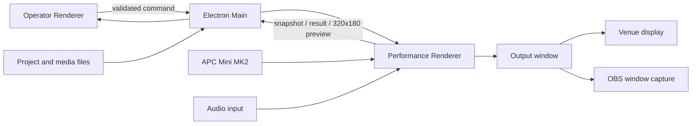

# Architecture

## Process ownership

`Performance Renderer` が PGM の唯一の実行状態を持ちます。Operator UI はコマンドを送信し、Runtime の snapshot を受け取って表示します。UI 側の予測だけで再生中表示や APC の LED を変更しません。

Electron Main はウィンドウ、権限、ファイル選択、保存、asset ID と絶対パスの対応を所有します。Renderer から任意パスを開く IPC は公開していません。`vjmedia://asset/<id>` は Main が登録したファイルだけを返し、動画 seek 用の Range リクエストを処理します。

Preload は役割別です。Operator はプロジェクト操作と Runtime コマンド、Performance は Runtime の受信と状態公開だけを受け取ります。両ウィンドウとも `nodeIntegration:false`、`contextIsolation:true`、`sandbox:true` です。

## Render path

1. L1〜L3 の動画、画像、単色、内蔵 generator を WebGL texture または GLSL source として取得します。
2. fit、opacity、mute、blend を適用して背面から合成します。
3. hue と UV distortion を適用します。
4. ping-pong FBO で前フレームを参照し、Echo を作ります。
5. Freeze 用 FBO は有効化時の最終演出を保持します。Runtime の動画・BeatClock・音声解析は進み続けます。
6. masterBrightness と blackout を表示直前の最終段へ適用します。

PGM の通常経路では CPU へ画素を戻しません。Operator の縮小プレビューだけを 320×180、最大 5fps で読み出します。

## Command flow

すべてのコマンドは `requestId` と単調増加の `sequence` を持ちます。Main と Performance の両方でスキーマを検証し、`pending`、`applied`、`rejected` を返します。

動画・画像の発火は次の順です。

1. 最新の要求を generation ID とともに登録する。
2. 現在の PGM を維持したまま新しい Source を準備する。
3. metadata、in 点の seek、最初のデコード可能フレームを確認する。
4. 準備完了後に次の量子化境界を計算する。
5. 描画フレームが境界を越えた最初の1回だけ active Source と入れ替える。
6. 古い generation の完了通知は破棄し、資源を解放する。

Scene は必要な全 Source を準備し、同一境界で一括適用します。通常の active 動画2本に対し、Scene 準備中は最大2本を追加する前提で、初期デコーダー予算4本に収めます。

## Domain layer

`src/shared/domain` は Electron、React、DOM に依存しません。

- `BeatClock`: 単調時刻から拍位置を導出し、BPM 変更時の位相を維持する
- `LaunchScheduler`: 準備待ち、量子化、最後の要求優先、取消
- `midi`: APC 座標変換、CC 正規化、pickup
- `modulation`: ms / beat 基準の包絡と clamp
- `projectSchema`: 保存データ、Source と Layer の制約、参照整合性

## Current v0.1 boundary

完成している描画経路は cut 切り替えです。レイヤー内の2 Source 同時保持による 0.25〜2拍クロスフェード、MIDI Learn の編集 UI、素材再リンク UI、autosave、サムネイルジョブ、複数ディスプレイの選択 UI は v1.0 の残作業です。Main の保存、Runtime、schema はこれらを追加できる境界で分かれています。
